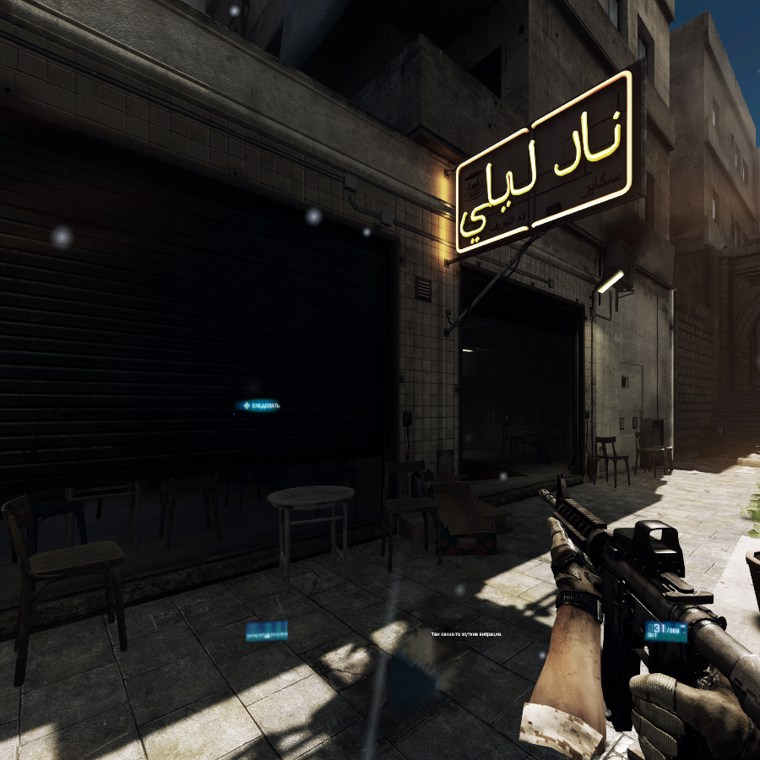

> [!IMPORTANT]
> **💬 DOWNLOAD & DISCUSSION**
>
> **[Join the Flat2VR Discord](https://discord.gg/P4q9zt7ek)** · **[Open the Battlefield 3 thread](https://discord.com/channels/747967102895390741/1565014042005737623)**
>
> Get the mod and share feedback in the game’s Flat2VR thread.

## 📦 INSTALLATION

1. Install the original **Battlefield 3** on PC and make sure you can start the campaign.
2. **Put the mod archive next to `bf3.exe`.** Extract the whole archive there and keep the mod folder intact.
3. Connect your PC VR headset, run **`RUN.bat`** from the extracted mod folder, and select **Campaign → Continue**.

## ⚡ FEATURES

### PULL A DROPPED GUN INTO REACH

Draw weapons from body slots, pass a gun between hands, or pull a dropped enemy weapon close enough to grab.

### A DIFFERENT SKY EACH TIME YOU LAUNCH

Fog, clouds, wind, rain and dust vary between runs. Watch the lighting change as day turns into night in the campaign.

### BRACE YOUR WEAPON OR REACH FOR A PROP

Grab the foregrip with your other hand to steady your aim, or use your free left hand to pull and release objects.

## 📸 In-game screenshots

  
  

[Community testing credits](https://github.com/Monsterdeadwood/C2VR/blob/main/TESTERS.md)

## 🎮 Other VR mods

| VR mod | Highlights |
| --- | --- |
| [Alone in the Dark (2008) VR](https://github.com/Monsterdeadwood/AloneInTheDark2008VR) | Tracked item handling and hand contact with walls |
| [Burnout Paradise Remastered VR](https://github.com/Monsterdeadwood/BUrnOutPvr) | Head-tracked driving with stereo boost and exhaust effects |
| [Crysis 2: VRevamp](https://github.com/Monsterdeadwood/C2VR) | Telekinesis, switchable weapon hands, and randomized weather and time of day |
| [NOVA · CS:GO Legacy VR](https://github.com/Monsterdeadwood/CSGOVR) | Controller aiming and working optics in local bot matches |
| [Metro 2033 VR](https://github.com/Monsterdeadwood/Metro2033VR) | Telekinesis, hand lightning, and object physics |
| [Rainbow Six Siege VR](https://github.com/Monsterdeadwood/SiegeVR) | Tracked weapons and two-handed foregrip handling |
| [Star Wars: The Force Unleashed II VR](https://github.com/Monsterdeadwood/TFU2VR) | Independent sabers, limb cuts, Force powers, and crate flight |
| [TimeShift VR](https://github.com/Monsterdeadwood/TimeShiftVR) | Randomized weather, day and night, and roomscale crouching |
| [Titanfall 1 VR](https://github.com/Monsterdeadwood/Titanfall1VR) | Aim with the controller and look around a Titan cockpit |
| [You Are Empty: Absolute Edition VR](https://github.com/Monsterdeadwood/YouAreEmptyAEVR) | Tracked weapons and melee with either hand |
