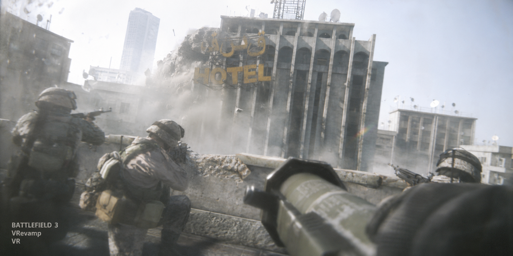
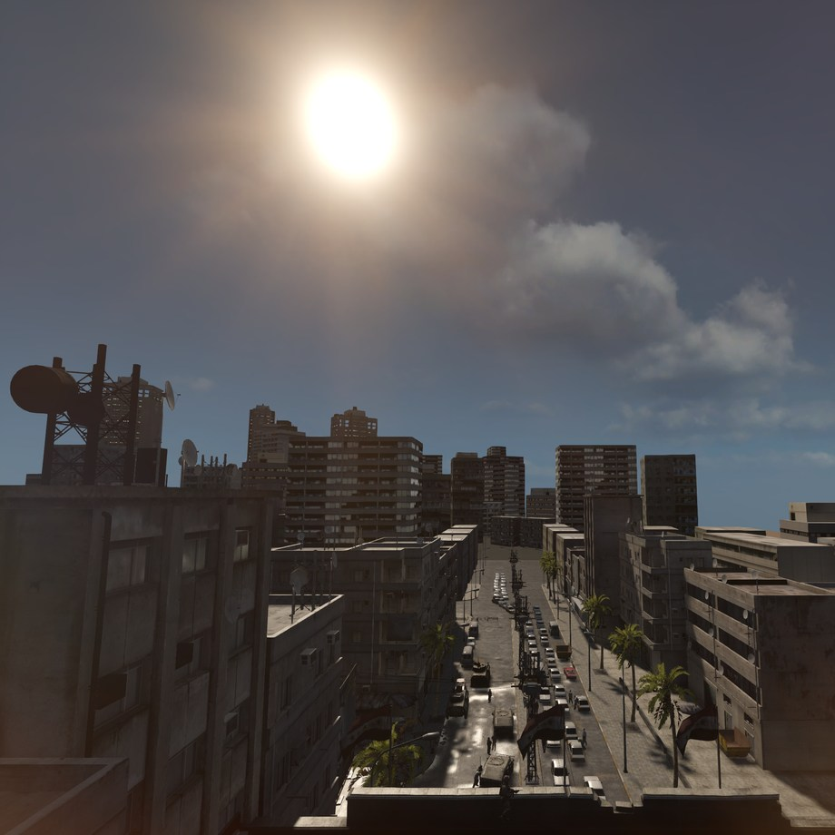

> [!IMPORTANT]
> **💬 TEST BUILDS & DISCUSSION**
>
> **[Join the Flat2VR Discord](https://discord.gg/P4q9zt7ek)** · **[Open the Battlefield 3 thread](https://discord.com/channels/747967102895390741/1565014042005737623)**
>
> Ask for the matching test build and share feedback in the thread.

## 📦 INSTALLATION

1. Install the supported original **Battlefield 3** PC build and make sure the campaign starts.
2. Extract the complete mod folder supplied for your build.
3. Connect PC VR, run **`RUN.bat`** in the mod folder, and select **Campaign → Continue**.

## ⚡ FEATURES

### DRAW, SWAP & PICK UP WEAPONS

Draw from body slots, transfer a weapon between hands, or pull a supported enemy weapon drop into reach and catch it with the other hand.

### A DIFFERENT SKY EACH TIME YOU LAUNCH

A fresh seed sets the campaign’s fog, clouds, wind, rain and dust. An accelerated day/night cycle changes the scene as you play.

### TWO-HANDED AIM & A FREE HAND FOR PROPS

Aim your gun with the controller, grab a supported foregrip to steady it, or use your free left hand to pull and release loose props.

R77 was tested in Operation Swordbreaker with XR Sim and XR Tape. The test covers that campaign route.

## 📸 In-game screenshots

  
  

[Community testing credits](https://github.com/Monsterdeadwood/C2VR/blob/main/TESTERS.md)

## 🎮 Other VR mods

| VR mod | Highlights |
| --- | --- |
| [Alone in the Dark (2008) VR](https://github.com/Monsterdeadwood/AloneInTheDark2008VR) | Tracked item handling and hand contact with walls |
| [Burnout Paradise Remastered VR](https://github.com/Monsterdeadwood/BUrnOutPvr) | Head-tracked driving with stereo boost and exhaust effects |
| [Crysis 2: VRevamp](https://github.com/Monsterdeadwood/C2VR) | Physical melee, object grabbing, and a rooftop weapon range |
| [NOVA · CS:GO Legacy VR](https://github.com/Monsterdeadwood/CSGOVR) | Controller aiming and working optics in local bot matches |
| [Metro 2033 VR](https://github.com/Monsterdeadwood/Metro2033VR) | Telekinesis, hand lightning, and object physics |
| [Rainbow Six Siege VR](https://github.com/Monsterdeadwood/SiegeVR) | Tracked weapons and two-handed foregrip handling |
| [Star Wars: The Force Unleashed II VR](https://github.com/Monsterdeadwood/TFU2VR) | Two tracked lightsabers and independent Force grip |
| [TimeShift VR](https://github.com/Monsterdeadwood/TimeShiftVR) | Randomized weather, day and night, and roomscale crouching |
| [Titanfall 1 VR](https://github.com/Monsterdeadwood/Titanfall1VR) | Aim with the controller and look around a Titan cockpit |
| [You Are Empty: Absolute Edition VR](https://github.com/Monsterdeadwood/YouAreEmptyAEVR) | Tracked weapons and melee with either hand |
